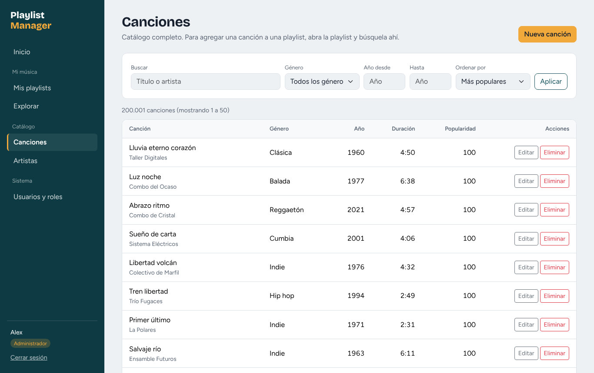
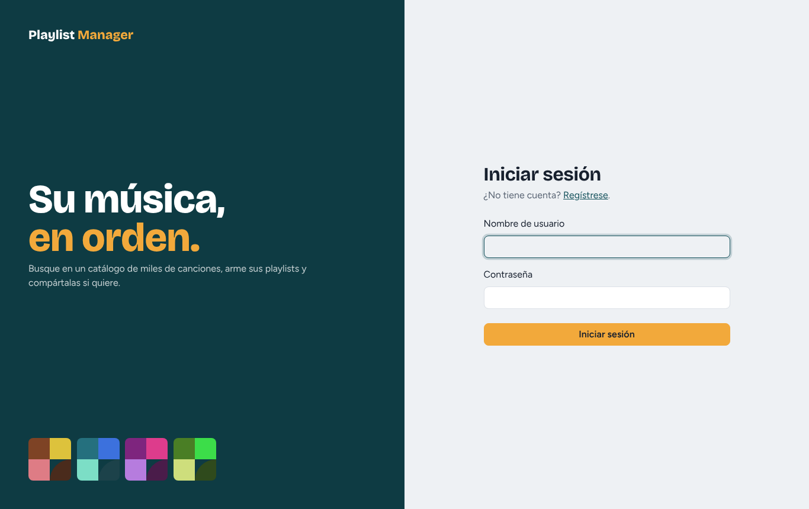
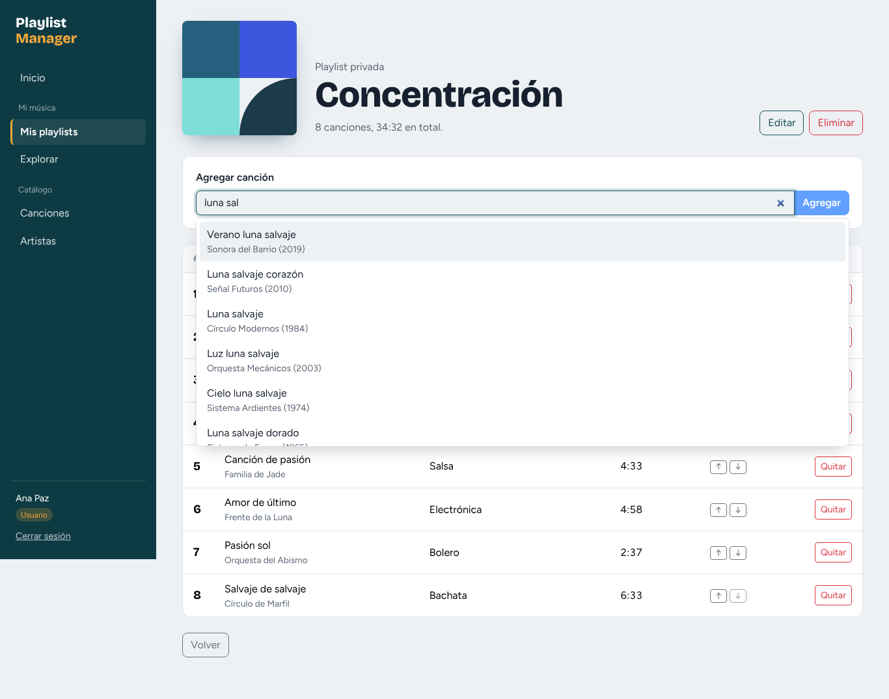
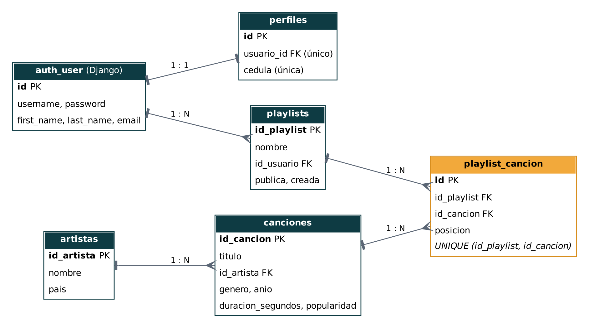

# Playlist Manager

Sistema web para organizar música, construido con **Django 5.2** y **PostgreSQL 16**.
Los administradores mantienen un catálogo de artistas y canciones; cada usuario arma sus
propias playlists con ese catálogo y decide si las comparte.

Este repositorio es material de estudio para la carrera de Sistemas de la Información:
el proyecto está terminado y viene acompañado de una **guía de construcción** que explica,
paso a paso, cómo se creó.



---

## Guía de construcción

> **[Descargar la guía: docs/Guia_Construccion_Playlist_Manager.docx](docs/Guia_Construccion_Playlist_Manager.docx)**
>
> GitHub no muestra archivos Word en el navegador: al abrir el enlace, use el botón
> **Download** (o "View raw") y ábralo con Word. Al abrirlo, acepte actualizar los campos
> para que se genere el índice.

La guía está pensada para leerse con el proyecto abierto en el computador. Cada capítulo
explica una etapa, muestra los fragmentos de código más importantes, indica en qué archivo
está el resto y termina con actividades de exploración y retos.

| Parte | Capítulos | Contenido |
|---|---|---|
| I. Preparación | 1 a 4 | Qué hace el sistema, instalación en Windows, Git básico y puesta en marcha |
| II. Construcción | 5 a 16 | Las 12 etapas de un sistema Django, en orden |
| Anexos | A a D | Mapa de URLs, comandos frecuentes, solución de problemas y glosario |

Las 12 etapas de la Parte II:

| Etapa | Capítulo | Tema | Archivos principales |
|---|---|---|---|
| 1 | 5 | Proyecto y aplicaciones | `Conf/manage.py`, `Conf/Conf/settings.py` |
| 2 | 6 | Configuración y variables de entorno | `Conf/Conf/settings.py`, `Conf/.env.example` |
| 3 | 7 | Modelos | `Conf/productos/models.py`, `Conf/Main/models.py` |
| 4 | 8 | Migraciones | `Conf/*/migrations/` |
| 5 | 9 | Panel de administración | `Conf/productos/admin.py`, `Conf/Main/admin.py` |
| 6 | 10 | Formularios y validaciones | `Conf/productos/forms.py`, `Conf/Main/validators.py` |
| 7 | 11 | Vistas y URLs | `Conf/productos/views.py`, `Conf/productos/urls.py` |
| 8 | 12 | Plantillas y archivos estáticos | `Conf/productos/templates/`, `Conf/productos/templatetags/` |
| 9 | 13 | Usuarios, inicio de sesión y roles | `Conf/Main/roles.py`, `Conf/Main/views.py` |
| 10 | 14 | Escalar a 200.000 canciones | `Conf/productos/views.py`, `static/productos/js/autocompletar.js` |
| 11 | 15 | Comandos de gestión | `Conf/productos/management/commands/` |
| 12 | 16 | Diseño visual | `Conf/productos/static/productos/css/app.css` |

---

## Funcionalidades

- **Inicio de sesión con dos roles.** *Usuario* consulta el catálogo y gestiona sus playlists;
  *Administrador* además crea, edita y elimina artistas y canciones.
- **Registro público** con validación de cédula ecuatoriana (módulo 10).
- **Playlists públicas o privadas.** Las públicas aparecen en la sección *Explorar*.
- **Reordenar canciones** dentro de una playlist (subir y bajar).
- **Catálogo de 200.000 canciones** con paginación, filtros por género y año, y orden por
  título, popularidad o año.
- **Búsqueda con autocompletado** para agregar canciones a una playlist.
- **Índices B-tree y GIN (`pg_trgm`)** que llevan las consultas de decenas de milisegundos a
  menos de uno.
- **Comandos de práctica:** `generar_datos` (datos de prueba con `generate_series`) y
  `comparar_indices` (EXPLAIN ANALYZE con y sin índices).

| Inicio de sesión | Detalle de una playlist |
|---|---|
|  |  |

---

## Tecnologías

| Tecnología | Uso |
|---|---|
| Python 3.12+ | Lenguaje del servidor |
| Django 5.2 | Framework web: URLs, vistas, formularios, plantillas, usuarios y ORM |
| PostgreSQL 16 | Base de datos (extensión `pg_trgm` para búsqueda de texto) |
| psycopg 3 | Conexión entre Python y PostgreSQL |
| python-dotenv | Lectura de contraseñas desde el archivo `.env` |
| Bootstrap 5.3 | Componentes de la interfaz (se carga desde internet) |

---

## Instalación en Windows

Requisitos: **Python 3.12 o superior** (marcar *Add python.exe to PATH* al instalar),
**PostgreSQL 16 con pgAdmin** y **Git**. El detalle de cada instalación está en el
capítulo 2 de la guía.

**1. Crear la base de datos.** En pgAdmin: clic derecho en *Databases* > *Create* >
*Database*, con el nombre `BDD_PBDD`.

**2. Clonar el repositorio y crear el entorno virtual.**

```powershell
git clone [URL del repositorio]
cd Proyecto_BDD
py -m venv venv
venv\Scripts\activate
pip install -r requirements.txt
```

Si PowerShell bloquea la activación, ejecutar una sola vez
`Set-ExecutionPolicy -Scope CurrentUser RemoteSigned`.

**3. Crear el archivo `.env`.**

```powershell
cd Conf
copy .env.example .env
python -c "from django.core.management.utils import get_random_secret_key as g; print(g())"
```

Abrir `Conf\.env`, pegar la clave generada en `SECRET_KEY` y escribir la contraseña de
PostgreSQL en `DB_PASSWORD`.

**4. Crear las tablas, el administrador y los datos de prueba.**

```powershell
python manage.py migrate
python manage.py createsuperuser
python manage.py generar_datos
```

**5. Ejecutar.**

```powershell
python manage.py runserver
```

Abrir <http://127.0.0.1:8000/>. Para detener el servidor: `Ctrl + C`.

---

## Primeros pasos

1. Iniciar sesión con el superusuario: tiene el rol Administrador.
2. Cerrar sesión, elegir **Regístrese** y crear una cuenta: recibe el rol Usuario.
3. Para convertir una cuenta en Administrador: entrar a `/admin/` con el superusuario,
   abrir **Usuarios**, elegir la cuenta y agregarla al grupo **Administrador**.

---

## Comandos útiles

Todos se ejecutan dentro de `Conf/` con el entorno virtual activo.

| Comando | Para qué sirve |
|---|---|
| `python manage.py runserver` | Iniciar el servidor de desarrollo |
| `python manage.py migrate` | Aplicar migraciones (también después de un `git pull`) |
| `python manage.py createsuperuser` | Crear un administrador |
| `python manage.py generar_datos` | Agregar 3.000 artistas y 200.000 canciones de prueba |
| `python manage.py generar_datos --reemplazar` | Igual, pero **borra antes** el catálogo actual |
| `python manage.py comparar_indices` | Comparar tiempos de consulta con y sin índices |
| `python manage.py comparar_indices --planes` | Mostrar además los planes de EXPLAIN completos |
| `python manage.py shell` | Probar consultas del ORM |

---

## Estructura del proyecto

```
Proyecto_BDD/
├── README.md
├── requirements.txt              dependencias de Python
├── GUIA_MEJORAS.md               resumen técnico de las mejoras y mediciones
├── CAMBIOS.md                    historial de correcciones
├── docs/
│   ├── Guia_Construccion_Playlist_Manager.docx   guía de construcción
│   └── img/                      capturas y diagramas
└── Conf/                         proyecto Django (aquí está manage.py)
    ├── .env.example              plantilla de variables de entorno
    ├── Conf/                     configuración: settings.py, urls.py
    ├── Main/                     cuentas: login, registro, roles, perfil
    └── productos/                música: artistas, canciones, playlists
        ├── management/commands/  generar_datos, comparar_indices
        ├── static/productos/     CSS y JavaScript
        ├── templates/productos/  páginas HTML
        └── templatetags/         filtros propios de plantillas
```

Modelo de datos:



---

## Problemas frecuentes

| Mensaje | Solución |
|---|---|
| `Falta la variable SECRET_KEY` | Falta `Conf/.env`: copiar `.env.example` y completarlo |
| `password authentication failed` | Corregir `DB_PASSWORD` en `.env` |
| `database "BDD_PBDD" does not exist` | Crear la base en pgAdmin con ese nombre exacto (mayúsculas incluidas) |
| `No module named 'django'` | Activar el entorno virtual y ejecutar `pip install -r requirements.txt` |
| La página se ve sin estilos | Bootstrap y las fuentes se cargan desde internet: revisar la conexión |

La lista completa está en el **Anexo C** de la guía de construcción.

---

## Importante

- El archivo `Conf/.env` contiene contraseñas y **no debe subirse** al repositorio.
  El `.gitignore` ya lo excluye; solo se versiona `.env.example`.
- `generar_datos --reemplazar` borra artistas, canciones y el contenido de las playlists.
  Usarlo solo en la base de datos de práctica.